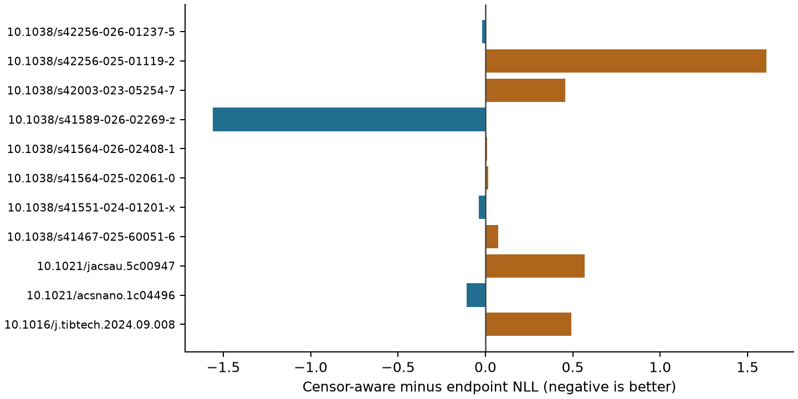
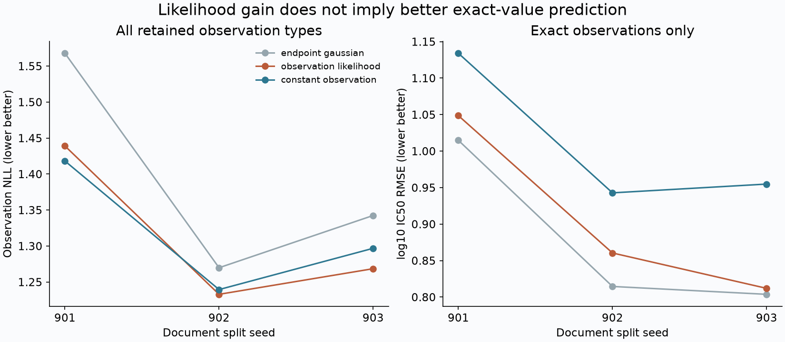

# Censor-aware Peptide Models

[](https://github.com/aarnavbhat23/censor-aware-peptide-models/actions/workflows/likelihood.yml)

Train on what a MIC observation says, including the part it does **not** say.

`MIC >64 µM` contributes a Gaussian survival probability, not a fabricated measurement at 64. This repository combines a stable censored likelihood, frozen ESM-2 representations, trainable potency heads, a synthetic identifiability check, and publication-held-out evaluation on a real literature-extracted assay table.



## Independent assay extension

The new experiment uses **17,099 source ChEMBL records**, retaining **15,099 hERG IC50 observations, 13,973 molecules and 2,239 documents**. There are 10,478 exact, 4,331 right-censored and 290 left-censored values. **No finite intervals occur in this snapshot**; interval correctness is validated numerically, not by a real interval-assay benchmark.



| Document split seed | Endpoint head NLL | Censor-aware head NLL | Constant censor-aware NLL |
|---|---:|---:|---:|
| 901 | 1.568 | 1.439 | **1.418** |
| 902 | 1.270 | **1.233** | 1.239 |
| 903 | 1.342 | **1.268** | 1.297 |

The matched heads use 2,048-bit Morgan fingerprints, a train-only 64-component PCA and the same 64-unit Gaussian head. Three document splits purge validation/test molecules from training, and test molecules from validation. Preserving censoring improves observation likelihood over endpoint training in each split, while **exact-only RMSE worsens in each split**. The proper constant model wins one split. This does not establish a uniformly useful molecular predictor, improved peptide potency prediction, or calibrated uncertainty.

The stronger constant-observation comparator was added **after inspecting the first external results**, fitted only on training data. That adaptive addition is recorded in the metric file. The analysis plan was committed before extension fits, after earlier peptide results were known; it was not independently preregistered. Read [the protocol](docs/EXTENSION_PROTOCOL.md) and [data attribution](data/CHEMBL_LICENSE.md).

```bash
python chembl_replay.py  # released snapshot, heads, strict split ledgers and all metrics
python chembl_predict.py 'CCO' --seed 901
python chembl_benchmark.py  # reconstruct all six molecular fits from the included snapshot
python plot_extension.py
# Optional current-API fetch; later releases may differ from the pinned snapshot:
python chembl_fetch.py
```

All six heads, predictions, per-document comparisons, original page checksums and 2,000 exclusions are in `results/chembl-herg/`. The pinned raw JSONL snapshot is included under ChEMBL CC BY-SA 3.0; code is MIT. hERG small-molecule IC50 and peptide MIC are different domains, kept separate throughout. Cell safety or therapeutic utility is not inferred.

## First experiment: an honest failure to beat the baseline

The upstream table has 6,448 rows. We retain **5,048 molar observations, 488 unique sequences and 11 papers**; 3,153 observations are censored. Another 1,400 mass-concentration rows are excluded because molecular weights and chemistry are not supplied. No molar/mass conversion is guessed.

| Training objective | Held-out observation NLL | Exact-only log10 MIC RMSE | Predicted mean outside a reported bound |
|---|---:|---:|---:|
| Endpoint Gaussian | 1.107 | 0.773 | 67.9% |
| Censor-aware likelihood | 1.195 | 1.425 | 45.1% |

Lower is better for the first two columns. Bound compliance is a diagnostic, **not measured prediction accuracy** for the unobserved MIC. The censor-aware model respects more bounds but has worse aggregate observation likelihood and exact-only errors. The paper-balanced NLL difference is +0.136, with a paper-resampling interval [-0.293, +0.560]. It does not establish an improvement.

A separate, explicitly **synthetic** 20,000-observation Gaussian experiment shows why the likelihood is still necessary: true mean/scale 1.5/0.6 are recovered as 1.505/0.610, while substituting the censoring endpoint estimates a biased mean of 1.079. This simulation assumes the data-generating model is correct; the literature experiment does not.

## Run and reproduce

```bash
python -m venv .venv
source .venv/bin/activate
python -m pip install -r requirements.txt
python -m unittest discover -s tests -v
python replay.py
python simulate.py
# Rebuild every publication-held-out fit:
python fetch.py
python encode.py --device cpu
python benchmark.py
python plot.py
# Use a specified released fold model; first call downloads free ESM weights:
python predict.py KLLKLLKKLLKLLK --fold 0
```

Frozen `facebook/esm2_t12_35M_UR50D` is pinned to revision `6fbf070e65b0b7291e7bbcd451118c216cff79d8`. Its final-layer residue means exclude padding and special tokens. It was not fine-tuned here. Each fitted head contains a 64-unit hidden layer and predicts a mean and positive scale in log10(MIC/µM) space. Encoding used MPS; head fitting used CPU. Python 3.13 and pinned library versions are recorded.

## Why the split matters

For each of 11 test publications, one other publication is reserved for validation. Every exact sequence occurring in test or validation is removed from training; test sequences are removed from validation too. Standardization is fitted on retained training rows. There is zero exact sequence overlap between training and test in every fold. This is an exact-match purge, not a certified sequence-family, chemistry or homology holdout.

The same head architecture and weight seed are used for both objectives. The baseline replaces bounds by endpoints for its **training objective only**. Both models select checkpoints using the original censored observation likelihood on validation rows, making evaluation comparable. The validation source is the next DOI in sorted cyclic order, not selected by its test result. Fold counts and selected epochs are public. Tiny validation papers make early stopping noisy.

The implementation uses `torch.special.log_ndtr` for stable log-survival and log-CDF terms, including extreme tails. It supports exact observations and one-sided censoring, rejects unsupported formats, preserves operator provenance, and tests the published likelihood identities and purging behavior. It now also supports ordered finite intervals, tested against independent quadrature, tail calculations, shrinking intervals and gradient checks. The original peptide table has only exact and one-sided observations.

## What the data cannot establish

The source is a **literature-extracted table**, not a newly collected experimental dataset, and every cited paper was not independently reverified for this release. Repeated assay rows and selection criteria can make the table unrepresentative. Organism, growth medium and peptide chemistry are not harmonized. Conditioning on sequence alone therefore predicts a marginal table distribution rather than an organism-specific potency.

Published bounds may reflect protocol-specific dilution grids and measurement decisions, so a censoring model can be correctly implemented and still be misspecified. No inactive negative class, chemical stereochemistry, cell safety, efficacy or experimental validation is inferred. The scale output is a fitted Gaussian parameter, not a proven calibrated uncertainty interval.

## Public artifacts

`results/checkpoints/` contains all 22 fitted heads and their train-only preprocessing. `data/esm35m.npz` and its manifest release the derived embeddings. `results/predictions.csv` includes every held-out prediction, original observation bounds, operator and NLL. `per-paper.csv`, `metrics.json`, and `training-history.json` retain source-level metrics and completed epoch histories. `replay.py` recomputes every NLL, aggregate error and bound diagnostic. `simulate.py` regenerates its separate synthetic experiment.

## Credit and contribution

Survival likelihoods and protein language-model probes are established methods. This is original implementation and a reproducible failure analysis, not a new ESM architecture or a first-ever censored potency model. Credit [ESM-2](https://github.com/facebookresearch/esm), [its model card](https://huggingface.co/facebook/esm2_t12_35M_UR50D), and the [pinned upstream assay extraction](https://github.com/aarnavbhat23/spear-wetlab-false-positive-audit/tree/5ac295c08f48aef43c991ba40a706f0e2fedb5b7). Every table row retains a publication DOI in the upstream source.

Code is MIT. Source data and pretrained dependencies retain their original attribution and terms. The source TSV is downloaded separately rather than repackaged as a new experimental dataset. A useful next contribution would harmonize organism and chemistry, independently validate source extraction, and repeat the comparison across validation-source choices. Built with AI assistance; no independent review or adoption claim is implied.
